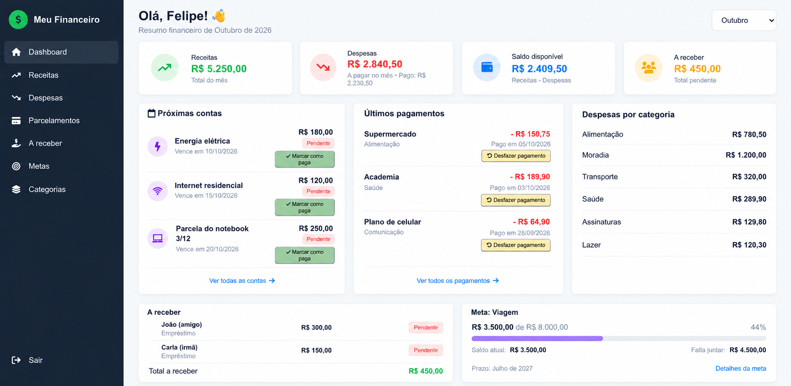

<h1 align="center">💰 Dashboard Financeiro – Gestão de Finanças Pessoais</h1>

  

## 📌 Descrição

O <strong>Dashboard Financeiro</strong> é uma aplicação web desenvolvida para facilitar o gerenciamento e a organização das finanças pessoais, oferecendo uma visão centralizada de receitas, despesas, parcelamentos e metas financeiras.

O sistema permite acompanhar movimentações mensais, controlar contas a pagar e valores a receber, além de monitorar o saldo disponível e o progresso de objetivos financeiros por meio de uma interface intuitiva e organizada.

---

## ✨ Funcionalidades

<ul>
  <li><strong>📊 Dashboard Interativo:</strong> Apresenta um resumo financeiro mensal com receitas, despesas, saldo disponível, próximas contas, últimos pagamentos e despesas organizadas por categoria.</li> 

  <li><strong>💰 Gerenciamento de Receitas:</strong> Permite cadastrar e acompanhar os valores recebidos, facilitando o controle das entradas financeiras.</li> 

  <li><strong>💸 Controle de Despesas:</strong> Possibilita registrar despesas fixas e variáveis, organizar vencimentos e acompanhar o status de pagamento de cada conta.</li> 

  <li><strong>💳 Gerenciamento de Parcelamentos:</strong> Permite acompanhar compras parceladas, visualizar parcelas pendentes e controlar seus respectivos pagamentos.</li> 

  <li><strong>🤝 Valores a Receber:</strong> Facilita o registro de valores emprestados a terceiros, permitindo acompanhar pendências e identificar pagamentos recebidos.</li> 

  <li><strong>🎯 Metas Financeiras:</strong> Permite estabelecer objetivos de economia, acompanhar o progresso das reservas e registrar depósitos ou retiradas.</li> 

  <li><strong>🗂️ Organização por Categorias:</strong> Classifica as despesas, proporcionando uma visualização mais detalhada dos gastos.</li> 

  <li><strong>📅 Consulta por Período:</strong> Permite visualizar as informações financeiras de diferentes meses, facilitando o acompanhamento do histórico financeiro.</li> 
</ul>

---

  <li><strong>HTML, CSS e JavaScript:</strong> Estruturação, estilização e interatividade das páginas.</li> 
</ul>
